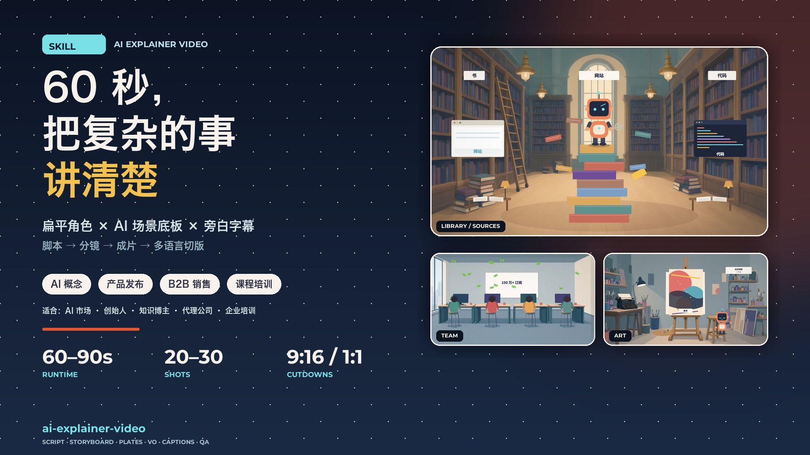
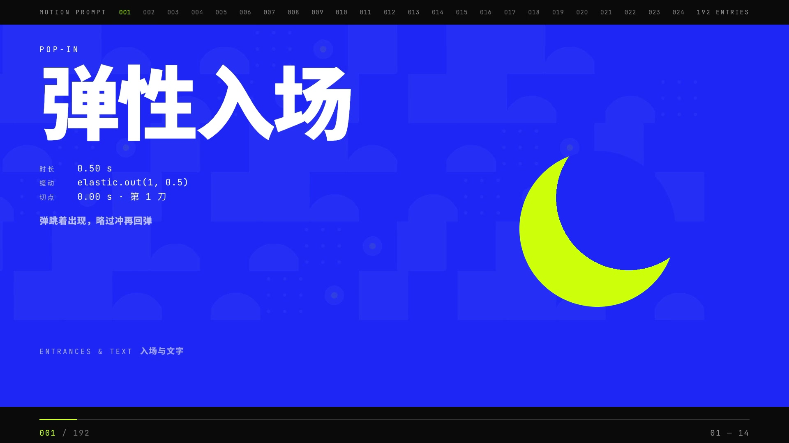
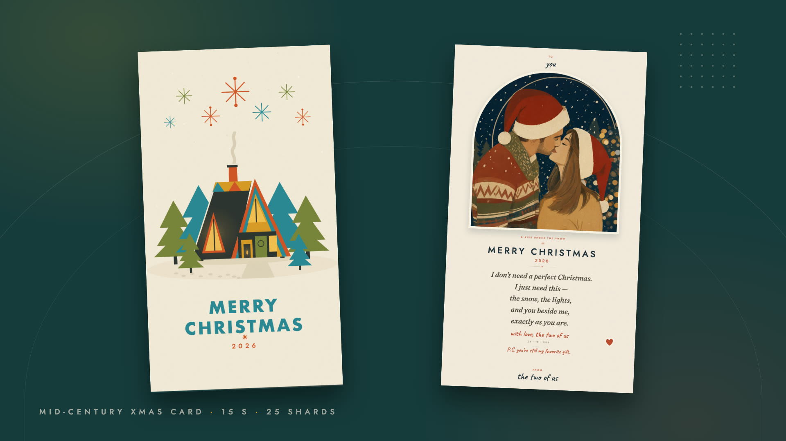

# AI-skill

A collection of reusable AI skills — packaged instructions, templates, and production checklists that other agents or teams can load and run.

## Skills

### [ai-explainer-video](ai-explainer-video/)

Turn a complex idea into a **60–90 second narrated explainer**: flat-vector characters over AI-generated background plates, with script, storyboard, voiceover, captions, SFX, QA, and 16:9 / 9:16 cutdowns.



**Use it for** — syncing a vocabulary, briefing a vendor, building a word list before prompting an AI, onboarding, course openers, proposals

**Who it's for** — design-system leads · motion designers · PMs writing briefs · anyone making video with AI

**Package contents**

```text
ai-explainer-video/
  SKILL.md                     # main skill contract and workflow
  UPLOAD.md                    # title / description / tags for the skill platform
  cover_16x9.jpg               # 1920x1080 cover
  cover_16x9_1280.jpg          # 1280x720 cover
  references/
    use-cases.md               # scenarios, audiences, buying triggers, fit check
    style-bible.md             # palette, type, characters, camera, transitions
    shot-grammar.md            # 10-beat / 25-shot template
    ai-plate-prompts.md        # master prompt, negative prompt, scene prompts
    qa-checklist.md            # pre-delivery checks
    offer.md                   # packaging, scoping, revision rules
  templates/
    brief.md
    script.md
    storyboard.csv
    voiceover.md
  examples/
    case-61s-12-plates.md      # real 61.9 s case study with costs and lessons
```

## How to use

1. Read `ai-explainer-video/SKILL.md`.
2. Run the fit check in `references/use-cases.md`.
3. Fill `templates/brief.md`, `templates/script.md`, `templates/storyboard.csv`.
4. Generate or select background plates with `references/ai-plate-prompts.md`.
5. Build characters/text in code or a motion tool.
6. Run `references/qa-checklist.md` before delivery.
7. Cut 9:16 / 1:1 versions and localize VO/captions.

## Design principles

- One thesis, one metaphor, one CTA.
- 20–30 shots for 60–90 s; 2–3 s per shot.
- AI for backgrounds with empty foreground; code for characters and text.
- Text is a label; narration is the argument.
- Hard cuts plus a few white splash wipes.
- Captions must work muted.
- Consistency beats novelty.

## License

MIT — see [LICENSE](LICENSE).

### [motion-lexicon-reel](motion-lexicon-reel/)

**卡住你的不是想象力，是不知道它叫什么。**

A 15-second reel that argues one thing: a motion has to have a **name** before anyone can make it. 14 named moves, each demonstrated on a geometric object while the card names it — so the viewer leaves with 14 working words instead of 14 definitions. Swiss 12-column grid, a drifting motif field, three real spec rows per entry, a player-style HUD, and a 24-tile index wall on the end card.



**Use it for**

- Design-system and motion-vocabulary teasers (easing, stagger, morph, glitch)
- "You can only build what you can name" posts and channel bumpers
- Component / icon / pattern library showreels
- Teaching design fundamentals, editing grammar, camera language
- Conference openers, proposal warm-ups, course chapter cards

**Package contents**

```text
motion-lexicon-reel/
  SKILL.md                     # main skill contract and workflow
  UPLOAD.md                    # title / description / tags for the skill platform
  cover_16x9.jpg               # 1920x1080 cover
  cover_16x9_1280.jpg          # 1280x720 cover
  references/
    style-bible.md             # grid numbers, type scale, palette, motif system, line discipline
    timeline.md                # the 14 x 0.9 s structure, retiming maths, audio sync
    qa-checklist.md            # pre-delivery checks
  template/
    index.html                 # HyperFrames root, 15.8 s
    compositions/sheet.html    # the whole film: cards, palette, motif field, timeline
    scripts/make_percussion.py # original 150 BPM percussion, cut-locked
  templates/
    entries.json               # the entry list (14 cards)
```

**Output spec** — 1920×1080 · 30 fps · 15.8 s · H.264 + AAC · −15.6 LUFS · no model calls, no stock footage.

### [midcentury-xmas-card](midcentury-xmas-card/)

**雪夜木屋 · 中叶现代主义圣诞贺卡。**

A 15-second portrait e-card in 1950s mid-century-modern flat geometry. A small envelope opens, the card grows to full screen, and the A-Frame cabin builds itself out of the snow line — starbursts pop, pines rise, the roof mass grows as one cut-paper shape, windows warm up, smoke draws, a trail of footprints walks to the door. Half a turn later the photo is **shattered into 25 irregular pieces that fly in and reassemble** inside an arched window, the letter wipes in line by line, and a heart jumps out of the kiss and settles into a wax seal.



**Use it for**

- Christmas / New Year e-cards sent as a 15-second vertical clip
- Couple or family cards built from one photo
- Brand holiday greetings, client thank-yous, year-end touches
- Social posts that need a physical-object feel (a real card on a real table)

**Package contents**

```text
midcentury-xmas-card/
  SKILL.md                     # contract, timeline, swap points, the three gotchas
  UPLOAD.md                    # title / description / tags for the skill platform
  cover_16x9.jpg               # 1920x1080 cover
  cover_16x9_1280.jpg          # 1280x720 cover
  preview/
    midcentury-xmas-card.mp4   # 15 s preview (720x1280)
    poster.jpg                 # back face, 1080x1920
  references/
    style-bible.md             # palette, type, geometry, motion tone
    cover-spec.md              # cover SVG coordinates, six structural fixes, build order
    shard-recipe.md            # the 25-shard jittered grid + GSAP SVG pitfalls
    qa-checklist.md            # pre-delivery checks
  template/
    index.html                 # the whole film: cover SVG, back layout, GSAP timeline
    render.mjs                 # Chrome frame stepping + ffmpeg
    check.mjs                  # key-frame spot checks
    assets/                    # fonts, paper grain, BGM + SFX, arch-window photo
```

**Output spec** — 1080×1920 · 30 fps · 15.0 s · H.264 + AAC · −18.8 dB mean / −2.2 dB peak · pure code render, no model calls.
