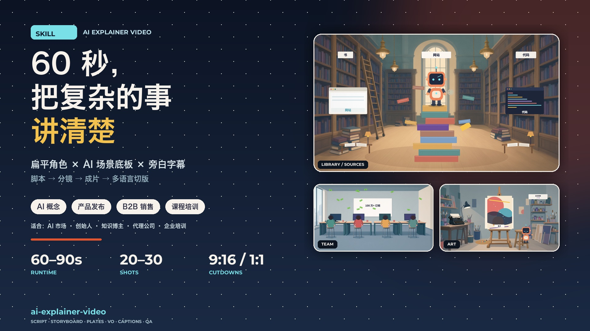

# AI-skill

A collection of reusable AI skills — packaged instructions, templates, and production checklists that other agents or teams can load and run.

## Skills

### [ai-explainer-video](ai-explainer-video/)

Turn a complex idea into a **60–90 second narrated explainer**: flat-vector characters over AI-generated background plates, with script, storyboard, voiceover, captions, SFX, QA, and 16:9 / 9:16 cutdowns.



**Use it for**

- AI / technology concept explainers
- Product launches and founder POV
- B2B sales, IR, and event loops
- Media explainer / video-essay content
- Courses, onboarding, internal training
- Multi-language and multi-aspect campaigns

**Package contents**

```text
ai-explainer-video/
  SKILL.md                     # main skill contract and workflow
  UPLOAD.md                    # title / description / tags for the skill platform
  cover_16x9.jpg               # 1920x1080 cover
  cover_16x9_1280.jpg          # 1280x720 cover
  references/
    use-cases.md               # scenarios, audiences, buying triggers, fit check
    style-bible.md             # palette, type, characters, camera, transitions
    shot-grammar.md            # 10-beat / 25-shot template
    ai-plate-prompts.md        # master prompt, negative prompt, scene prompts
    qa-checklist.md            # pre-delivery checks
    offer.md                   # packaging, scoping, revision rules
  templates/
    brief.md
    script.md
    storyboard.csv
    voiceover.md
  examples/
    case-61s-12-plates.md      # real 61.9 s case study with costs and lessons
```

## How to use

1. Read `ai-explainer-video/SKILL.md`.
2. Run the fit check in `references/use-cases.md`.
3. Fill `templates/brief.md`, `templates/script.md`, `templates/storyboard.csv`.
4. Generate or select background plates with `references/ai-plate-prompts.md`.
5. Build characters/text in code or a motion tool.
6. Run `references/qa-checklist.md` before delivery.
7. Cut 9:16 / 1:1 versions and localize VO/captions.

## Design principles

- One thesis, one metaphor, one CTA.
- 20–30 shots for 60–90 s; 2–3 s per shot.
- AI for backgrounds with empty foreground; code for characters and text.
- Text is a label; narration is the argument.
- Hard cuts plus a few white splash wipes.
- Captions must work muted.
- Consistency beats novelty.

## License

MIT — see [LICENSE](LICENSE).
