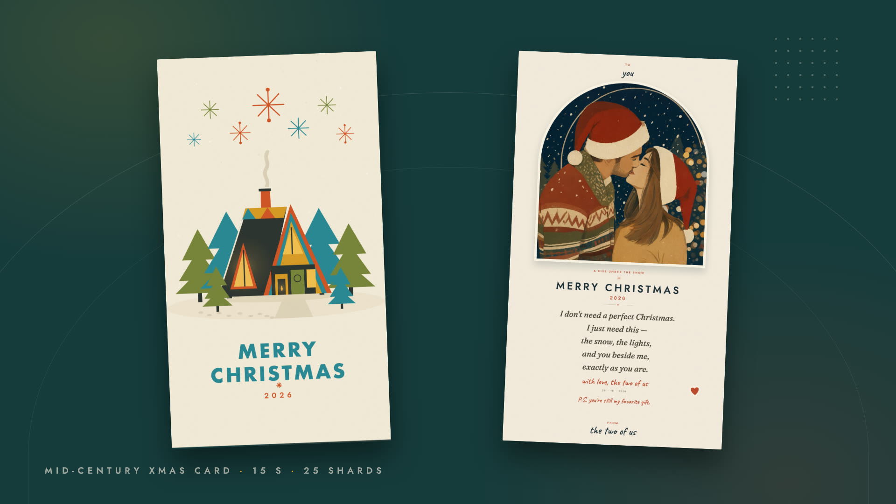

# Mid-Century Xmas Card

**雪夜木屋 · 中叶现代主义圣诞贺卡（15 s）**

一张 1080×1920 的竖版电子贺卡：信封锁版 → 卡片长到全屏 → 几何木屋从雪线长出来 →
半翻面 → 照片碎成 25 块飞入、拼成一扇拱形窗 → 五行信 → 爱心落成火漆印。



- **成片**：[preview/midcentury-xmas-card.mp4](preview/midcentury-xmas-card.mp4) · 720×1280 预览版（原片 1080×1920）
- **封面**：`cover_16x9.jpg` / `cover_16x9_1280.jpg`
- **背面**：`preview/poster.jpg`

## 包内容

```text
midcentury-xmas-card/
  SKILL.md                     # 契约、时间线、换文案/换图的入口、三个坑
  UPLOAD.md                    # 平台标题 / 描述 / 标签
  cover_16x9.jpg               # 1920×1080 封面
  cover_16x9_1280.jpg          # 1280×720 封面
  preview/
    midcentury-xmas-card.mp4   # 720×1280 预览成片（15 s）
    poster.jpg                 # 背面 1080×1920
  references/
    style-bible.md             # 色号、字体、几何、动画语气
    cover-spec.md              # 封面 SVG 坐标表 + 六处结构修正 + 长出顺序
    shard-recipe.md            # 25 块不规则碎片的做法 + GSAP SVG 的三个坑
    qa-checklist.md            # 交付前检查
  template/
    index.html                 # 整支片子：封面 SVG、背面版式、GSAP 时间线
    render.mjs                 # Chrome 逐帧 + ffmpeg
    check.mjs                  # 关键帧抽查
    assets/                    # 字体、颗粒、音效、拱形窗照片
```

## 跑起来

```bash
cd template
npm i
node render.mjs --out renders/card.mp4     # 1080×1920 / 15.000s / 30fps / H.264+AAC
```

macOS + Chrome + Node 18+ + ffmpeg；无网络、无模型调用。

## 想改什么

| 改 | 位置 |
|---|---|
| 封面插画 | `template/index.html` 里的 `<svg class="cover cover-cabin">`（规则见 `references/cover-spec.md`） |
| 照片 | 裁成 820×880 覆盖 `template/assets/img/004/kiss-arch.jpg` |
| 称呼 / 落款 / 正文 | `#toBlock`、`#fromBlock`、`.msg-line` |
| 年份 / 日期 | `#coverYear`、`#backYear`、`#backDate` |
